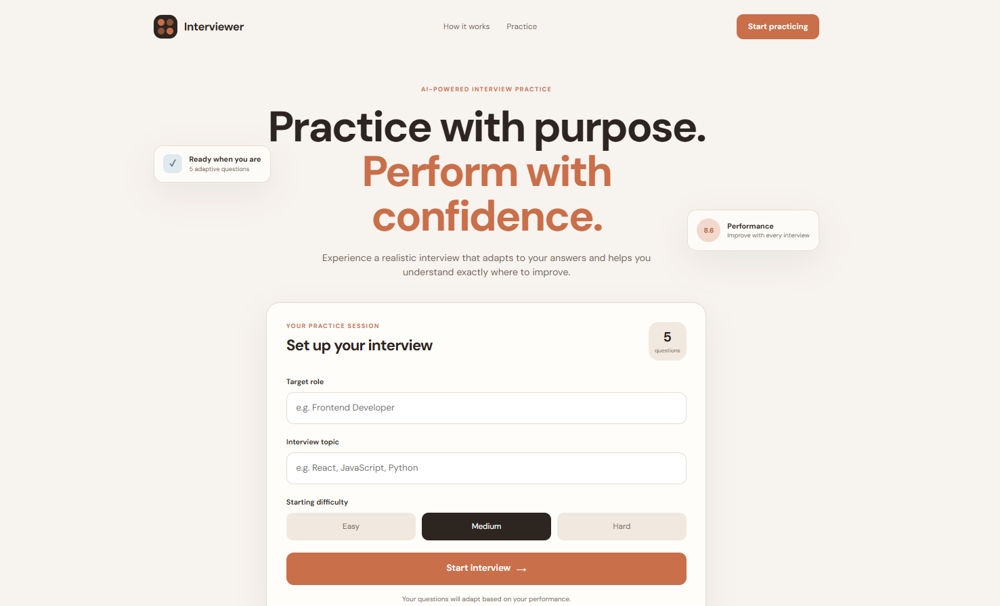
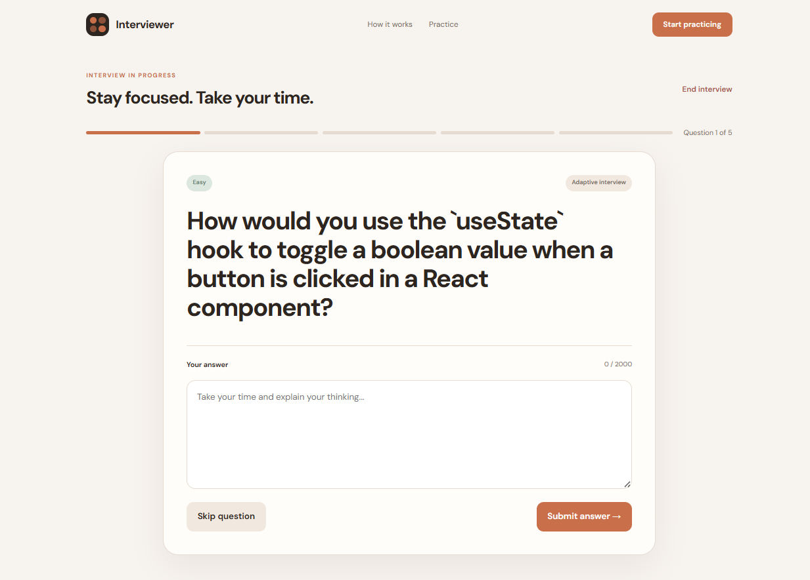
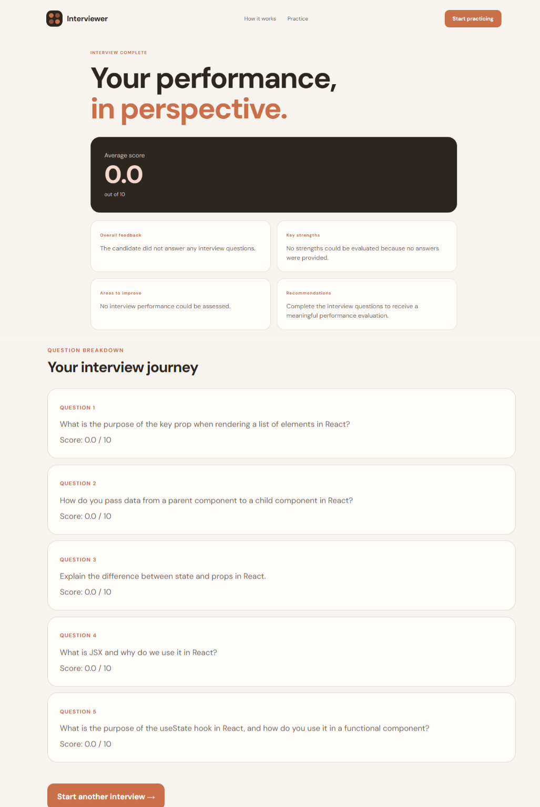
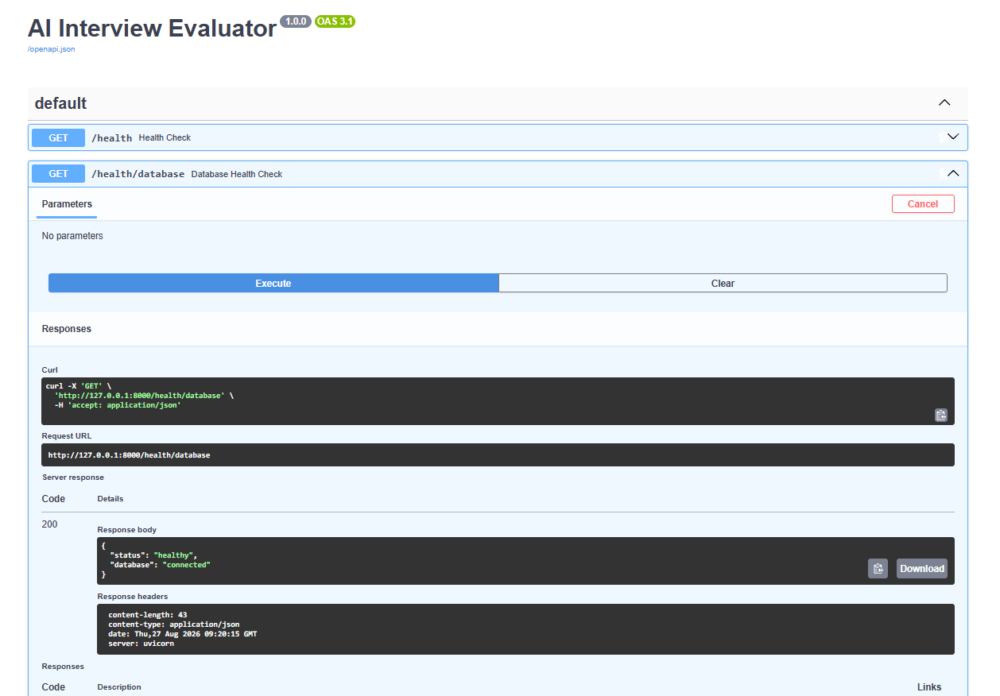

# 🎤 AI Interview Evaluator

An AI-powered technical interview platform built with **FastAPI**, **Groq LLMs**, **SQLAlchemy**, **PostgreSQL/Supabase**, and a vanilla **JavaScript** frontend.

The application conducts a structured 5-question technical interview, dynamically adjusts question difficulty based on candidate performance, evaluates answers using an LLM, and generates a final performance report.

---

## 📑 Table of Contents

- [✨ Features](#-features)
- [🖼️ Screenshots](#️-screenshots)
- [⚙️ How It Works](#️-how-it-works)
- [🧠 AI Evaluation Flow](#-ai-evaluation-flow)
- [📈 Adaptive Difficulty](#-adaptive-difficulty)
- [📊 Final Report](#-final-report)
- [🛠️ Tech Stack](#️-tech-stack)
- [🗄️ Database Architecture](#️-database-architecture)
- [📁 Project Structure](#-project-structure)
- [🔌 API Endpoints](#-api-endpoints)
- [🔑 Environment Variables](#-environment-variables)
- [🚀 Local Setup](#-local-setup)
- [🧪 Running Tests](#-running-tests)
- [🔒 Security](#-security)
- [🐳 Docker](#-docker)
- [🎯 Current Scope](#-current-scope)
- [📄 License](#-license)

---

## ✨ Features

- 🤖 AI-generated technical interview questions
- 🎯 Role- and topic-based interviews
- 📈 Adaptive interview difficulty
- 🧠 LLM-powered answer evaluation
- 📝 Structured evaluation with score, feedback, strengths, and weaknesses
- ⏭️ Skip-question support without unnecessary LLM calls
- ⚠️ Empty-answer handling
- ✅ Automatic interview completion after 5 questions
- 📊 AI-generated final performance report
- 🗂️ Question-by-question evaluation history
- 🔄 Interview resume support after browser refresh
- 🚪 Interview abandonment
- 🐘 PostgreSQL database through Supabase
- 🔌 REST API with FastAPI
- ✅ Input validation for interview role/topic
- 🧪 Comprehensive API testing with pytest

---

## 🖼️ Screenshots

| Dashboard | Interview |
|---|---|
|  |  |

| Final Report | FastAPI Backend |
|---|---|
|  |  |

---

## ⚙️ How It Works

```
Create Interview
       │
       ▼
Validate Role & Topic
       │
       ▼
Start Interview
       │
       ▼
Generate Question
       │
       ▼
Candidate Answers / Skips
       │
       ▼
Evaluate Answer
       │
       ▼
Adjust Difficulty
       │
       ▼
Generate Next Question
       │
       ▼
Repeat Until 5 Questions
       │
       ▼
Generate Final Report
```

---

## 🧠 AI Evaluation Flow

The application intentionally avoids unnecessary LLM calls. 💰

```
                    Candidate Response
                           │
             ┌─────────────┼─────────────┐
             ▼             ▼             ▼
        Real Answer    Empty Answer      Skip
             │             │             │
             ▼             ▼             ▼
          Groq LLM      Score = 0      Score = 0
             │             │             │
             └─────────────┴─────────────┘
                           │
                           ▼
                    Update Difficulty
                           │
                           ▼
                    Continue Interview
```

| Case | Behavior |
|---|---|
| ✅ **Real answer** | A non-empty answer is sent to the Groq LLM for evaluation. Returns a **score**, **feedback**, **strengths**, and **weaknesses**. |
| ⚠️ **Empty answer** | Does not call the LLM. Receives a score of `0` with predefined feedback. |
| ⏭️ **Skipped question** | Stored with an empty answer and score `0`, but excluded from the candidate's answered-question statistics. |

This design prevents unnecessary AI requests and avoids spending API resources on questions the candidate did not answer.

---

## 📈 Adaptive Difficulty

Question difficulty changes according to the candidate's performance on the previous question.

| Score | Effect |
|---|---|
| 🟢 `>= 8` | Increase difficulty |
| 🟡 `5 – 7.99` | Maintain / normal progression |
| 🔴 `< 5` | Decrease difficulty |

Skipped or empty questions receive a score of `0`, so difficulty adapts accordingly.

---

## 📊 Final Report

After the fifth question is completed, the backend automatically finalizes the interview. The report contains:

- 📉 Average score
- 🔢 Total questions
- ✅ Answered questions
- 💬 Overall feedback
- 💪 Strengths
- 🧩 Weaknesses
- 💡 Recommendations
- 🏆 Strongest answered question
- 🪫 Weakest answered question
- 🗂️ Question-by-question evaluations

Skipped questions are still displayed in the report, but their answer is represented as `null` and they do not contribute to the average score.

**Example:**

```
5 total questions
3 answered
2 skipped

Average score = (score1 + score2 + score3) / 3
```

---

## 🛠️ Tech Stack

**Backend**
- 🐍 Python
- ⚡ FastAPI
- 🦄 Uvicorn
- 🗃️ SQLAlchemy
- 📦 Pydantic / Pydantic Settings

**AI**
- 🧠 Groq API
- ❓ LLM-based question generation
- 📝 LLM-based answer evaluation
- 📊 LLM-based final report generation

**Database**
- 🐘 PostgreSQL
- ☁️ Supabase
- 🗃️ SQLAlchemy ORM

**Frontend**
- 🌐 HTML / CSS
- ⚡ Vanilla JavaScript

**Testing**
- 🧪 pytest
- 🔌 FastAPI TestClient
- 📡 httpx

**Deployment**
- 🐳 Docker
- ☁️ Cloud deployment
- ☁️ Supabase PostgreSQL

---

## 🗄️ Database Architecture

```
InterviewSession
       │
       ├── InterviewQuestion
       │       │
       │       └── CandidateAnswer
       │               │
       │               └── AnswerEvaluation
       │
       └── InterviewReport
```

Related records use cascading deletion, so removing an interview session also removes its dependent questions, answers, evaluations, and report.

---

## 📁 Project Structure

```
interview-evaluator/
│
├── app/
│   ├── __init__.py
│   ├── ai.py
│   ├── database.py
│   ├── difficulty.py
│   ├── input_validator.py
│   ├── main.py
│   ├── models.py
│   ├── question_generator.py
│   ├── report_generator.py
│   └── schemas.py
│
├── tests/
│   ├── __init__.py
│   └── test_api.py
│
├── frontend/
│   ├── index.html
│   ├── style.css
│   └── script.js
│
├── public/
│   ├── backend-health.png
│   ├── dashboard.png
│   ├── interview.png
│   └── report.png
│
├── .env.example
├── .gitignore
├── pytest.ini
├── requirements.txt
└── README.md
```

---

## 🔌 API Endpoints

**Health**
```
GET  /health
GET  /health/database
```

**Interview**
```
POST /interviews
POST /interviews/validate-input
POST /interviews/{session_id}/start
GET  /interviews/{session_id}
POST /interviews/{session_id}/complete
POST /interviews/{session_id}/abandon
GET  /interviews/{session_id}/report
```

**Questions**
```
POST /interviews/{session_id}/questions
GET  /interviews/{session_id}/questions
POST /interviews/{session_id}/generate-question
POST /questions/{question_id}/skip
```

**Answers**
```
POST /questions/{question_id}/answers
POST /answers/{answer_id}/evaluate
```

---

## 🔑 Environment Variables

Create a `.env` file in the project root:

```env
DATABASE_URL=your_supabase_postgresql_connection_string
GROQ_API_KEY=your_groq_api_key
```

> ⚠️ Never commit the `.env` file. A `.env.example` file is included to show the required configuration without exposing secrets.

---

## 🚀 Local Setup

### 1️⃣ Clone the repository

```bash
git clone https://github.com/YOUR_USERNAME/interview-evaluator.git
cd interview-evaluator
```

### 2️⃣ Create a virtual environment

**Windows:**
```bash
python -m venv .venv
.venv\Scripts\activate
```

**macOS / Linux:**
```bash
python -m venv .venv
source .venv/bin/activate
```

### 3️⃣ Install dependencies

```bash
pip install -r requirements.txt
```

### 4️⃣ Configure environment variables

Copy `.env.example` to `.env` and add your own values:

```env
DATABASE_URL=...
GROQ_API_KEY=...
```

### 5️⃣ Run the backend

```bash
uvicorn app.main:app --reload
```

FastAPI's interactive Swagger docs are available at the `/docs` route once the server is running.

### 6️⃣ Run the frontend

Open `frontend/index.html` using a local development server — for example, VS Code's **Live Server** extension, and open the frontend through the generated local URL.

---

## 🧪 Running Tests

```bash
pytest -v
```

The project contains a comprehensive API test suite covering interview creation, question generation, answer submission, evaluation, skipping, completion, reports, error cases, and other interview-flow scenarios.

---

## 🔒 Security

- 🔐 Sensitive configuration (Groq API keys, database credentials) is stored in `.env` and excluded from Git via `.gitignore`.
- 🌐 For production deployment, CORS should be restricted to the actual deployed frontend domain rather than allowing every origin.

---

## 🐳 Docker

The application is designed to be containerized for deployment. The Docker setup allows the FastAPI backend and its Python dependencies to run consistently across development and production environments.

---

## 🎯 Current Scope

This version focuses on the core AI interview experience:

```
Interview → AI Questions → Candidate Answers → AI Evaluation → Adaptive Difficulty → Final Report
```

Authentication and persistent user-specific interview history are intentionally planned as a future version.

---

## 📄 License

This project is intended as a personal portfolio and learning project.